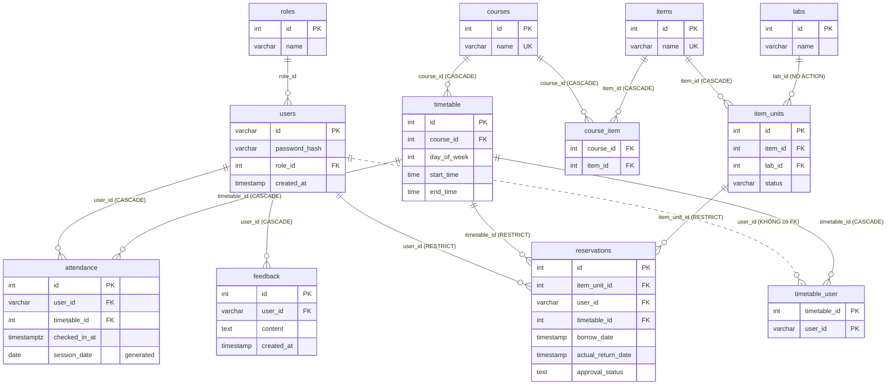
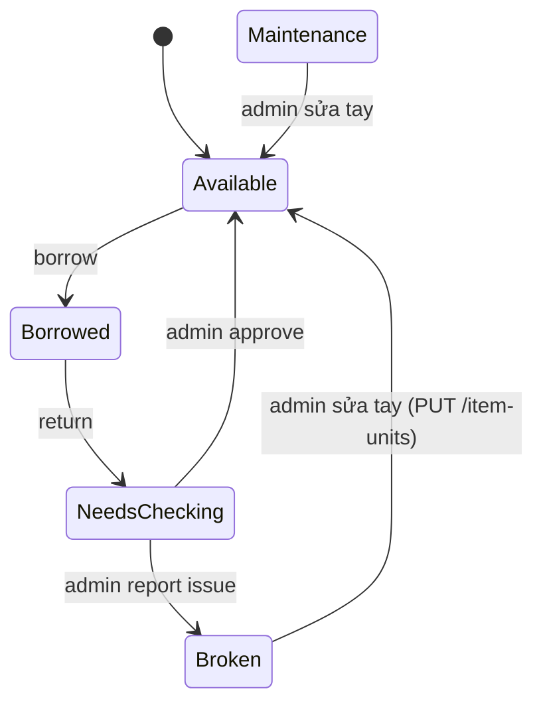

# Thiết kế Database — Trạng thái hiện tại

Tài liệu mô tả **đầy đủ schema Postgres hiện tại** của Project-A, tức là kết quả sau khi
áp toàn bộ migration `0000` → `0003` trong `backend/services/db-service/migrations/`.

- Muốn biết *vì sao* schema thay đổi so với bản dump cũ → xem
  [`db-schema-design.md`](./db-schema-design.md) (trước/sau) và
  [`db-schema-review.md`](./db-schema-review.md) (quá trình phát hiện vấn đề).
- File này là **tham chiếu cho trạng thái hiện tại**: bảng, cột, ràng buộc, quan hệ, view,
  luồng nghiệp vụ dùng DB, và các điểm còn tồn tại.

Nguồn sự thật (source of truth) luôn là các file migration — nếu tài liệu này lệch với
migration thì migration đúng.

---

## 1. Tổng quan kiến trúc

```
Frontend (React)  ──HTTP──▶  Node backend (Express)  ──HTTP──▶  db-service (FastAPI + asyncpg)  ──▶  Postgres 18
                                                     (DB_SERVICE_URL)                               (database: project_a)
```

| Thành phần | Vai trò với DB |
|---|---|
| Postgres 18 (`docker-compose.yml`, service `postgres`) | Lưu dữ liệu, volume `pgdata`. Khởi động **trống**, không mount script init nào. |
| `db-service` (`backend/services/db-service/main.py`) | **Nơi duy nhất chứa SQL.** Raw SQL qua asyncpg, pool 1–10 kết nối, không ORM. |
| Node backend (`backend/models/*.js`) | Không kết nối Postgres trực tiếp; gọi HTTP sang `db-service`. |
| yoyo-migrations | Quản lý schema. `entrypoint.sh` chạy `yoyo apply --batch` (retry tối đa 10 lần) trước khi start `uvicorn`. |

Cấu hình kết nối (`db-service`): `DB_USER`, `DB_PASSWORD`, `DB_HOST`, `DB_PORT` (mặc định
5432), `DB_NAME` (mặc định `project_a`).

---

## 2. Sơ đồ quan hệ (ERD)



Các nhóm nghiệp vụ:

| Nhóm | Bảng |
|---|---|
| Người dùng & phân quyền | `roles`, `users` |
| Lớp học & lịch | `courses`, `timetable`, `timetable_user` |
| Điểm danh | `attendance` |
| Thiết bị & phòng lab | `items`, `item_units`, `labs`, `course_item` |
| Mượn/trả thiết bị | `reservations`, view `v_reservations` |
| Phản hồi | `feedback` |

---

## 3. Chi tiết từng bảng

Quy ước: **PK** = khóa chính, **FK** = khóa ngoại, **UK** = unique. Mọi cột `id integer`
có default `nextval('<table>_id_seq')` (sequence `OWNED BY` cột đó).

### 3.1 `roles` — vai trò người dùng

| Cột | Kiểu | Null | Default | Ghi chú |
|---|---|---|---|---|
| `id` | `integer` | NOT NULL | `nextval('roles_id_seq')` | PK |
| `name` | `varchar(100)` | NULL | | Tên role, code tra theo tên |

- Dữ liệu tham chiếu được seed **ngay trong migration `0000`** (không phải dev seed):
  `('student')` → id 1, `('admin')` → id 2. Thứ tự quan trọng vì dữ liệu cũ dùng `role_id = 1`
  cho student.
- `create_user` gán role bằng `(SELECT id FROM roles WHERE name = 'student')`.
- `GET /users/{id}` trả về `r.name AS role` — Node dùng chuỗi `'student'`/`'admin'` để phân quyền.

### 3.2 `users` — tài khoản

| Cột | Kiểu | Null | Default | Ghi chú |
|---|---|---|---|---|
| `id` | `varchar(255)` | NOT NULL | `nextval('users_id_seq')` (*) | PK — chính là username/mã người dùng |
| `created_at` | `timestamp` (không TZ) | NOT NULL | `now()` | |
| `password_hash` | `varchar(255)` | NOT NULL | | bcrypt (`$2a$`/`$2b$`) |
| `role_id` | `integer` | NULL | | FK → `roles.id` (không ON DELETE → NO ACTION) |

(*) Default `nextval` trên cột varchar là di sản từ dump cũ; app luôn truyền `id` tường
minh nên default này không bao giờ được dùng (xem mục 8).

### 3.3 `courses` — môn học

| Cột | Kiểu | Null | Ghi chú |
|---|---|---|---|
| `id` | `integer` | NOT NULL | PK |
| `name` | `varchar(50)` | NOT NULL | UK (`courses_name_key`) |

### 3.4 `timetable` — khung giờ lớp học lặp hàng tuần ("class")

| Cột | Kiểu | Null | Ghi chú |
|---|---|---|---|
| `id` | `integer` | NOT NULL | PK. API gọi là `class_id` / `timetable_id` |
| `course_id` | `integer` | NULL | FK → `courses.id` ON DELETE CASCADE |
| `day_of_week` | `integer` | NOT NULL | CHECK `0..6` (`timetable_day_of_week_check`), 0 = Chủ nhật — khớp `EXTRACT(DOW ...)` của Postgres |
| `start_time` | `time` | NOT NULL | |
| `end_time` | `time` | NOT NULL | |

Một dòng `timetable` **không phải một buổi học cụ thể** mà là một slot lặp lại mỗi tuần
(vd. "cos1, thứ Hai 09:00–10:30"). Một buổi cụ thể = `timetable_id` + ngày.

### 3.5 `timetable_user` — ghi danh sinh viên vào lớp

| Cột | Kiểu | Null | Ghi chú |
|---|---|---|---|
| `timetable_id` | `integer` | NOT NULL | PK (phần 1), FK → `timetable.id` ON DELETE CASCADE |
| `user_id` | `varchar(255)` | NOT NULL | PK (phần 2). **Không có FK** sang `users` |

- PK: `(timetable_id, user_id)` — một user chỉ ghi danh một lần mỗi lớp.
- Index: `idx_timetable_user_user_id (user_id)` — phục vụ tra "lớp hiện tại của user".

### 3.6 `attendance` — điểm danh

| Cột | Kiểu | Null | Default | Ghi chú |
|---|---|---|---|---|
| `id` | `integer` | NOT NULL | sequence | PK |
| `user_id` | `varchar(255)` | NOT NULL | | FK → `users.id` ON DELETE CASCADE |
| `timetable_id` | `integer` | NOT NULL | | FK → `timetable.id` ON DELETE CASCADE |
| `checked_in_at` | `timestamptz` | NOT NULL | `now()` | |
| `session_date` | `date` | — | **GENERATED ALWAYS AS** `(checked_in_at AT TIME ZONE 'UTC')::date` STORED | Thêm ở `0001` |

- UK: `attendance_user_timetable_session_unique (user_id, timetable_id, session_date)` —
  mỗi sinh viên điểm danh tối đa 1 lần / lớp / ngày (UTC), nhưng điểm danh được ở nhiều tuần.
- Không được INSERT/UPDATE `session_date` trực tiếp (cột generated).

### 3.7 `items` — loại thiết bị

| Cột | Kiểu | Null | Ghi chú |
|---|---|---|---|
| `id` | `integer` | NOT NULL | PK |
| `name` | `varchar(50)` | NOT NULL | UK (`items_name_key`) |

### 3.8 `labs` — phòng lab

| Cột | Kiểu | Null | Ghi chú |
|---|---|---|---|
| `id` | `integer` | NOT NULL | PK |
| `name` | `varchar(100)` | NULL | |

### 3.9 `item_units` — từng thiết bị vật lý

| Cột | Kiểu | Null | Default | Ghi chú |
|---|---|---|---|---|
| `id` | `integer` | NOT NULL | sequence | PK — mã thiết bị (dùng cho QR) |
| `item_id` | `integer` | NULL | | FK → `items.id` ON DELETE CASCADE |
| `lab_id` | `integer` | NULL | | FK → `labs.id` (NO ACTION) |
| `status` | `varchar(20)` | NOT NULL | `'Available'` | CHECK (`item_units_status_check`, thêm ở `0003`) |

Giá trị hợp lệ của `status`:

| Giá trị | Ý nghĩa | Ai set |
|---|---|---|
| `Available` | Sẵn sàng cho mượn | default khi tạo; Node khi admin approve trả |
| `Borrowed` | Đang được mượn | `db-service` `borrow_item` |
| `Needs Checking` | Đã trả, chờ admin kiểm tra | `db-service` `return_item` |
| `Broken` | Hỏng, không cho mượn | Node (`AdminController` report-issue) |
| `Maintenance` | Đang bảo trì | Chỉ được đếm trong `/inventory/stats`, hiện không luồng nào set |

- Index: `idx_item_units_item_id (item_id)`.

### 3.10 `course_item` — thiết bị được dùng trong môn học (N–N)

| Cột | Kiểu | Null | Ghi chú |
|---|---|---|---|
| `course_id` | `integer` | NULL | FK → `courses.id` ON DELETE CASCADE |
| `item_id` | `integer` | NULL | FK → `items.id` ON DELETE CASCADE |

Không có PK/unique → có thể chèn trùng cặp `(course_id, item_id)` (xem mục 8).

### 3.11 `reservations` — lượt mượn thiết bị

| Cột | Kiểu | Null | Default | Ghi chú |
|---|---|---|---|---|
| `id` | `integer` | NOT NULL | sequence | PK |
| `item_unit_id` | `integer` | NULL | | FK → `item_units.id` ON DELETE RESTRICT |
| `user_id` | `varchar(255)` | NULL | | FK → `users.id` ON DELETE RESTRICT |
| `timetable_id` | `integer` | NULL | | FK → `timetable.id` ON DELETE RESTRICT — lớp mà user đang học lúc mượn |
| `borrow_date` | `timestamp` (không TZ) | NOT NULL | `now()` | |
| `actual_return_date` | `timestamp` (không TZ) | NULL | | NULL = chưa trả |
| `approval_status` | `text` | NOT NULL | `'pending'` | CHECK `IN ('pending','approved','issue_reported')` (thêm ở `0002`) |

Index:

| Tên | Định nghĩa | Mục đích |
|---|---|---|
| `idx_reservations_item_unit_id` | `(item_unit_id)` | |
| `idx_reservations_timetable_id` | `(timetable_id)` | lọc theo lớp |
| `idx_reservations_user_id` | `(user_id)` | lịch sử mượn của user |
| `uq_one_active_borrow` | **UNIQUE** `(item_unit_id) WHERE actual_return_date IS NULL` | Partial unique index: **mỗi thiết bị chỉ có tối đa 1 lượt mượn đang mở**. `borrow_item` dựa vào nó qua `ON CONFLICT (item_unit_id) WHERE actual_return_date IS NULL DO NOTHING` |

Trạng thái của một reservation được xác định bởi **2 cột**:

| `actual_return_date` | `approval_status` | Ý nghĩa |
|---|---|---|
| NULL | `pending` | Đang mượn |
| NOT NULL | `pending` | Đã trả, chờ admin duyệt |
| NOT NULL | `approved` | Admin xác nhận trả tốt |
| NOT NULL | `issue_reported` | Admin báo thiết bị có vấn đề |

Lưu ý: query-param `status` của API (`not_returned` / `overdue` / `returned`) lọc theo
`actual_return_date`, **không** liên quan đến `approval_status`.

### 3.12 `feedback` — phản hồi người dùng

| Cột | Kiểu | Null | Default | Ghi chú |
|---|---|---|---|---|
| `id` | `integer` | NOT NULL | sequence | PK |
| `user_id` | `varchar(255)` | NOT NULL | | FK → `users.id` ON DELETE CASCADE |
| `content` | `text` | NOT NULL | | |
| `created_at` | `timestamp` (không TZ) | NOT NULL | `now()` | |

---

## 4. View `v_reservations`

Định nghĩa hiện tại (tạo lại ở `0002`):

```sql
CREATE VIEW v_reservations AS
 SELECT r.id, r.borrow_date, r.actual_return_date, r.approval_status, r.timetable_id,
        i.name AS item_name, iu.id AS item_unit_id, u.id AS user_id,
        c.name AS course_name, l.name AS lab_name,
        t.day_of_week, t.start_time, t.end_time
   FROM reservations r
     JOIN item_units iu ON iu.id = r.item_unit_id
     JOIN items i       ON i.id = iu.item_id
     JOIN users u       ON u.id::text = r.user_id::text
     JOIN timetable t   ON t.id = r.timetable_id
     JOIN courses c     ON c.id = t.course_id
     JOIN labs l        ON l.id = iu.lab_id;
```

- Là view "đã phẳng hóa" phục vụ mọi màn hình danh sách mượn/trả: `/users/{id}/reservations`,
  `/reservations`, `/reservations/pending-returns`, `/reservations/logs`, `/reservations/{id}`.
- Toàn bộ là **INNER JOIN** → reservation nào có thiết bị không gắn lab (`lab_id IS NULL`),
  hoặc thiếu `timetable_id`/`course_id`, sẽ **không xuất hiện** trong view (xem mục 8).
- Đổi cột của view phải `DROP VIEW` rồi `CREATE` lại (Postgres không cho
  `CREATE OR REPLACE VIEW` bỏ cột).

---

## 5. Hành vi khi xóa (ON DELETE)

| Xóa dòng ở | Ảnh hưởng |
|---|---|
| `users` | Xóa kèm `attendance`, `feedback`. **Bị chặn** nếu user còn `reservations` (RESTRICT). `timetable_user` **không bị xóa** (không có FK → để lại dòng mồ côi). |
| `courses` | Xóa kèm `timetable` (→ dây chuyền xuống `timetable_user`, `attendance`) và `course_item`. Bị chặn nếu bất kỳ timetable nào của môn còn `reservations`. |
| `timetable` (`DELETE /classes/{id}`) | Xóa kèm `timetable_user`, `attendance`. **Bị chặn** nếu còn `reservations`. |
| `items` (`DELETE /items/{id}`) | Xóa kèm `item_units`, `course_item`. Bị chặn nếu unit nào còn `reservations`. |
| `item_units` (`DELETE /item-units/{id}`) | **Bị chặn** nếu còn `reservations`. |
| `labs` | **Bị chặn** nếu còn `item_units` trỏ tới (NO ACTION). |
| `roles` | **Bị chặn** nếu còn `users` trỏ tới. |

Khi bị chặn, `db-service` hiện trả lỗi 500 (chưa map lỗi FK violation thành 4xx).

---

## 6. Luồng nghiệp vụ dùng DB

### 6.1 Đăng ký / đăng nhập

- Đăng ký: `POST /users` → `INSERT users (id, password_hash, role_id = role 'student')`.
- Đăng nhập: `GET /users/{id}` → join `roles` lấy tên role, Node so khớp bcrypt.

### 6.2 Điểm danh (face/QR)

1. `GET /users/{id}/valid-timetable`: tìm slot mà user đã ghi danh (`timetable_user`) có
   `day_of_week = EXTRACT(DOW FROM NOW())` và `NOW()::time BETWEEN start_time AND end_time`.
2. `POST /attendance`: `INSERT ... ON CONFLICT (user_id, timetable_id, session_date) DO NOTHING`.
   Nếu đã điểm danh trong ngày (UTC) → trả lại bản ghi cũ, không lỗi.

### 6.3 Mượn thiết bị — `POST /reservations/borrow` (1 transaction)

1. `SELECT ... FROM item_units WHERE id = $1 FOR UPDATE` — khóa dòng thiết bị.
2. Từ chối nếu `status = 'Broken'` (400) hoặc `'Borrowed'` (409).
3. Kiểm tra item có thuộc ít nhất một môn trong `course_item` (400 nếu không).
4. Tìm lớp đang diễn ra của user (`timetable_user` + `timetable` theo giờ hiện tại) (404 nếu không có).
5. `INSERT reservations (item_unit_id, user_id, timetable_id)` với
   `ON CONFLICT ... WHERE actual_return_date IS NULL DO NOTHING` — `approval_status` lấy default `'pending'`.
6. `UPDATE item_units SET status = 'Borrowed'`.

### 6.4 Trả thiết bị — `POST /reservations/{id}/return` (1 transaction)

1. `UPDATE reservations SET actual_return_date = NOW() WHERE id = $1 AND actual_return_date IS NULL`.
2. `UPDATE item_units SET status = 'Needs Checking'`.

### 6.5 Admin duyệt trả

| Hành động | `reservations.approval_status` (db-service) | `item_units.status` (Node gọi tiếp `PUT /item-units`) |
|---|---|---|
| Approve | `pending` → `approved` | → `Available` |
| Report issue | `pending` → `issue_reported` | → `Broken` |

Hai bước này **không cùng transaction** (2 HTTP call riêng từ Node).

### 6.6 Vòng đời trạng thái thiết bị



Lưu ý: `borrow_item` chỉ chặn `Broken` và `Borrowed` — thiết bị ở trạng thái
`Needs Checking` hoặc `Maintenance` **vẫn mượn được**.

### 6.7 Thống kê

- `/inventory/stats`: đếm `item_units` theo `Borrowed` / `Maintenance` / `Available`.
- `/reservations/stats/dashboard`: `active_borrows` (chưa trả), `pending_returns` (đã trả, `pending`).
- Bộ lọc `overdue`: `actual_return_date IS NULL AND DATE(borrow_date) < CURRENT_DATE`
  (mượn từ hôm trước mà chưa trả).

---

## 7. Quản lý schema & dữ liệu

### 7.1 Migration

| File | Nội dung |
|---|---|
| `0000.baseline_schema.sql` | Toàn bộ `CREATE TABLE`/sequence/PK/FK/index/view chép từ dump cũ, + seed `roles` |
| `0001.attendance_session_date.sql` | `attendance.session_date` (generated) + unique `(user_id, timetable_id, session_date)` |
| `0002.reservations_approval_status.sql` | Xóa `is_approved`; `approved boolean` → `approval_status text` + CHECK + default; tạo lại `v_reservations` (thêm `timetable_id`) |
| `0003.item_units_status_check.sql` | CHECK 5 giá trị cho `item_units.status` |

Quy tắc thêm migration mới:

1. Tạo file `NNNN.<mô_tả>.sql` trong `backend/services/db-service/migrations/`, dòng đầu
   `-- depends: <migration trước>`.
2. Không sửa migration đã áp — luôn thêm file mới.
3. Nếu đổi cột mà view đang dùng → `DROP VIEW` + `CREATE VIEW` trong cùng migration.
4. Thêm `NOT NULL` cho cột mới thì cần `DEFAULT` hoặc backfill, và kiểm tra các `INSERT`
   trong `main.py` không set cột đó.
5. Khởi động lại `db-service` để `yoyo apply` tự chạy. yoyo lưu lịch sử trong các bảng
   `_yoyo_*` của chính database.

### 7.2 Dữ liệu mẫu

`database/seed/dev_seed.sql` (không tự chạy): 2 course, 12 timetable, 3 user
(`user1`, `user2` = student; `admin` = admin), 3 item, 8 item_unit, 2 lab, 1 reservation mẫu.

```
docker compose exec -T postgres psql -U postgres -d project_a < database/seed/dev_seed.sql
```

### 7.3 Tham chiếu

`database/schema-reference/baseline_2026-10.sql` — bản `pg_dump --schema-only` gốc trước
migration, **chỉ để tham khảo**, không tool nào áp file này.

---

## 8. Điểm còn tồn tại / cần lưu ý

Các vấn đề quan sát được từ schema và code hiện tại, chưa được xử lý:

| # | Vấn đề | Hệ quả |
|---|---|---|
| 1 | `'Broken'` (Node report-issue) vs `'Maintenance'` (`/inventory/stats`) | Thiết bị báo hỏng không được đếm trong thống kê; `Maintenance` không có luồng nào set. Cần quyết định nghiệp vụ. |
| 2 | `timetable_user.user_id` không có FK → `users` | Có thể ghi danh user không tồn tại; xóa user để lại dòng mồ côi. |
| 3 | `course_item` không có PK/unique, 2 cột đều nullable | Có thể chèn trùng hoặc NULL. |
| 4 | Các FK `reservations.item_unit_id/user_id/timetable_id`, `item_units.item_id`, `timetable.course_id`, `users.role_id` đều nullable | Dòng thiếu tham chiếu bị INNER JOIN của `v_reservations` loại bỏ âm thầm. |
| 5 | `v_reservations` INNER JOIN `labs` trong khi `item_units.lab_id` nullable | Lượt mượn thiết bị không gắn lab không hiển thị ở mọi màn hình danh sách. |
| 6 | `roles.name` không unique, nullable | Lookup `WHERE name = 'student'` có thể trả nhiều dòng → `create_user` lỗi. |
| 7 | `users.id` (varchar) có default `nextval('users_id_seq')` | Di sản vô nghĩa; không gây lỗi vì app luôn truyền `id`. |
| 8 | Kiểu thời gian lẫn lộn: `attendance.checked_in_at` là `timestamptz`, còn `reservations.*_date`, `users.created_at`, `feedback.created_at` là `timestamp` không TZ | Phụ thuộc timezone của session Postgres; `session_date` cố định UTC trong khi kiểm tra giờ học dùng `NOW()` theo timezone server. |
| 9 | `borrow_item` chỉ kiểm tra item thuộc *một môn bất kỳ*, không kiểm tra môn đó có phải môn của lớp user đang học | Có thể mượn thiết bị của môn khác. |
| 10 | Approve/report-issue cập nhật `reservations` và `item_units` qua 2 HTTP call riêng | Không atomic — lỗi giữa chừng để lại trạng thái lệch. |
| 11 | Thiết bị `Needs Checking`/`Maintenance` vẫn mượn được | Có thể chưa đúng ý đồ nghiệp vụ. |
| 12 | Lỗi ràng buộc (CHECK, FK RESTRICT) trả HTTP 500 | Client không phân biệt được lỗi dữ liệu với lỗi hệ thống. |
